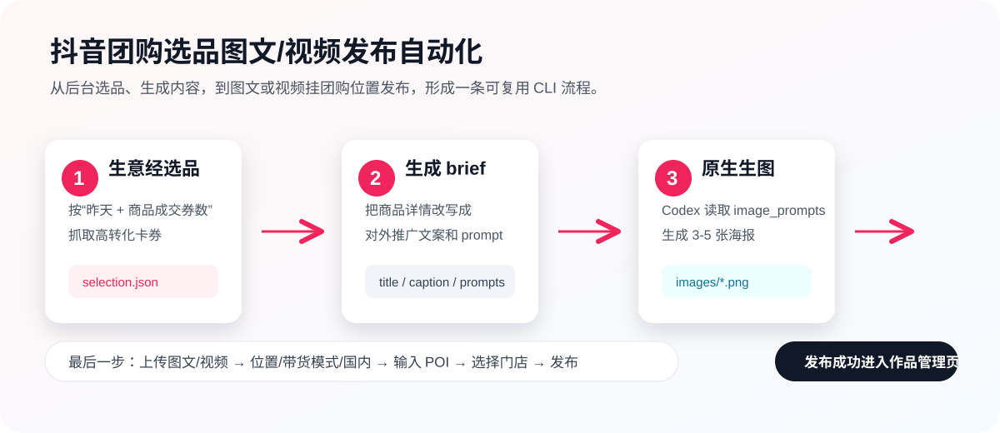
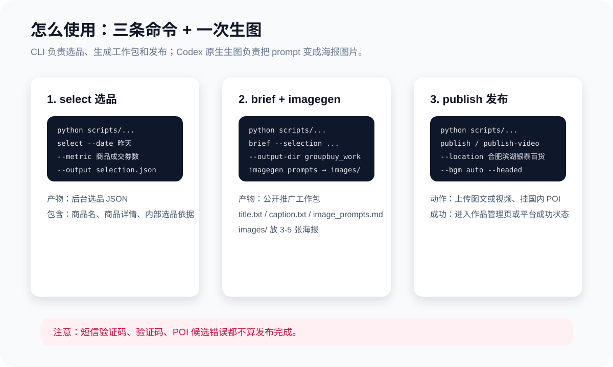
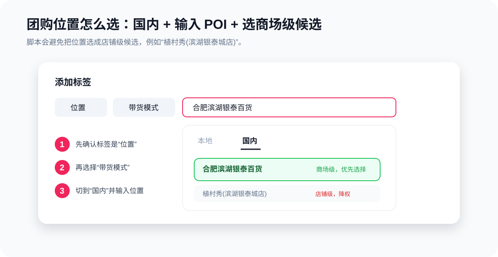
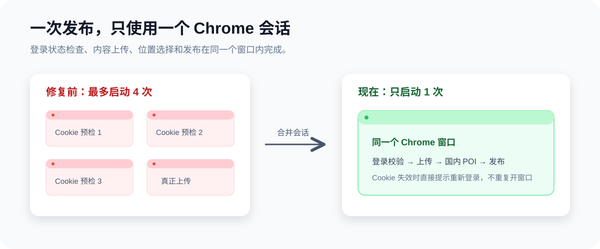

# 抖音团购选品图文/视频发布自动化


把抖音本地生活内容生产里最重复的操作串成一条命令链：

**生意经选品 → 查询商品详情 → 生成公开推广工作包 → 原生生图 → 发布图文或视频 → 挂国内团购位置。**



## 一眼看懂

| 你提供什么 | 脚本自动处理什么 | 最后得到什么 |
| --- | --- | --- |
| 来客主体、已登录 Chrome 和选品条件 | 从生意经读取排名商品，再查询所选一张商品详情 | `selection.json` |
| 选中的卡券和推广门店 | 生成标题、正文、图片提示词和发布元数据 | 一套公开推广工作包 |
| 3-5 张生图海报 | 上传图片、选择音乐、挂国内 POI | 抖音团购图文 |
| 一条已经生成的视频 | 填写标题简介、挂带货位置并发布 | 抖音团购视频 |
| 一批确认过的视频和竖封面 | 单个 Chrome 会话逐条发布、核对账号和新作品回执、保存进度 | 可续跑回执、短视频链接及JSON/CSV/Markdown清单 |

## 脚本能做什么

### 1. 从生意经选卡券

- 当前支持“昨天”单日，按商品成交金额或商品成交券数取前 1-10 个商品。
- 默认使用 OpenCLI 复用已登录 Chrome，并验证日期、排序指标和降序状态。
- 获取商品 ID 后回到抖音来客商品管理，查询所选一张卡券的详情。
- 内部数据只用于选品，不会自动写进公开推广文案。

### 2. 生成公开推广工作包

脚本会把商品信息整理成：

```text
groupbuy_work/
├── title.txt
├── caption.txt
├── image_prompts.md
├── publish_meta.json
└── images/
```

`image_prompts.md` 可直接交给 Codex 的 `imagegen` 技能，生成 3-5 张原生图片。脚本不会用 HTML 截图冒充生图。

### 3. 发布团购图文

- 上传 3-5 张图片。
- 按内容选择推荐音乐，或使用指定音乐。
- 填写标题、正文和话题。
- 挂“位置 + 带货模式 + 国内”门店 POI。
- 发布成功后进入作品管理页。

### 4. 发布团购视频

已经有 MP4 时，不需要重新走选品和生图。直接执行 `publish-video`：

```bash
./bin/douyin-groupbuy publish-video \
  --account demo_douyin \
  --file /path/to/video.mp4 \
  --title "猛男被叫美女后，真香买了19.9逛吃卡" \
  --desc "中大银泰服务台短剧，19.9逛吃卡真香反转。" \
  --tags "杭州中大银泰,19块9逛吃卡,杭州团购,本地生活" \
  --location "杭州中大银泰百货" \
  --headed
```

这条命令会完成：上传视频、填写作品信息、选择国内门店位置、点击发布和检查成功状态。

### 5. 一条命令批量发布与续跑

把已确认的视频、竖封面和简短文案写入 `batch.json`，先校验：

```bash
./bin/douyin-groupbuy publish-batch \
  --manifest /path/to/batch.json --state-dir /path/to/batch-state \
  --account demo_douyin --expected-account demo_douyin_id \
  --dry-run
```

获准发布后去掉 `--dry-run`。CLI 等待创作者主页显示真实抖音号，精确核对账号，再复用单个 Chrome 会话逐条上传；每条作品检查竖封面、标题、AI 声明，并选择团购位置。它上传清单中的文件，不加工原片或替换配音。

同一条命令再次运行会跳过已有匹配回执的作品。发布按钮只点击一次；提交结果不明时保留状态并停止，避免重复发布。回执确认提交，与平台审核、公开可见和音频播放验收分别记录。清单格式、运行环境和恢复规则见 [批量发布 CLI](references/batch-publish.md)。

每条核验回执都会自动回收作品链接，并在 `--state-dir` 写入 `publish-results.json`、`publish-results.csv`、`publish-results.md`。已有批次无需再次发布即可导出：

```bash
./bin/douyin-groupbuy collect-results \
  --manifest /path/to/batch.json --state-dir /path/to/batch-state \
  --account demo_douyin --expected-account demo_douyin_id
```

此命令只读已有回执并写入汇总，不开Chrome、不修改逐条发布状态，也不刷新审核或播放状态。单条视频要回收链接时，用一项清单调用 `publish-batch`；旧 `publish-video` 及图文入口不支持此导出。生成清单保留在本地任务目录，不提交GitHub。

## 命令和产物



常用入口有八个：

| 命令 | 用途 |
| --- | --- |
| `select` | 从生意经选品并查询所选一张商品详情 |
| `detail` | 按商品 ID 或已保存榜单查询一张卡券详情 |
| `brief` | 生成公开推广工作包 |
| `publish` | 发布团购图文并选择音乐 |
| `publish-video` | 发布团购视频并挂国内位置 |
| `publish-batch` | 单浏览器批量视频发布、回执确认与断点续跑 |
| `collect-results` | 从已有核验回执回收短视频链接，导出JSON/CSV/Markdown清单 |
| `run` | 选品、生成工作包，并可接续准备好的素材发布 |

## 团购位置不会只“输入”不“选择”

位置发布按固定顺序执行：

1. 添加标签选择“位置”。
2. 进入“带货模式”。
3. 切换到“国内”。
4. 输入完整门店名。
5. 等待候选加载。
6. 选择匹配的商场级候选。



候选项会按名称和门店类型评分。例如目标是“合肥滨湖银泰百货”时，商场级位置优先于“植村秀（滨湖银泰城店）”这类店铺级位置。

## 一次发布只启动一个持久在线浏览器

旧流程会在正式上传前最多启动 3 次 Chrome 检查 Cookie，真正上传时再启动一次。现在登录校验、上传、位置选择和发布共用同一个浏览器会话。



CLI 会给每个账号使用独立 Profile：

```text
$SOCIAL_AUTO_UPLOAD_HOME/browser_profiles/douyin_<账号名>/
```

新账号或新 Profile 第一次可能需要扫码；扫码完成后，当前 `publish-video` 命令会继续上传、挂位置并发布。后续同账号通常直接复用登录态，不需要每条视频都先跑 `douyin check`。如果平台触发风控、短信或验证码，保留 `--headed` 在同一个窗口里处理。

2026-09-15 已用“六安银泰百货”视频发布链路做过本机验收：扫码登录后，命令继续完成上传、填写、选择位置和发布。

## 安装

```bash
git clone https://github.com/784697524-ux/douyin-groupbuy-publisher.git
cd douyin-groupbuy-publisher
./install.sh
./scripts/apply_douyin_groupbuy_patch.sh
```

默认使用本机运行环境：

```text
$HOME/.openclaw/workspace/social-auto-upload
```

应用脚本会安装团购位置、视频位置、单浏览器发布和持久登录 Profile 四组补丁。重复执行是安全的；已经存在的补丁会被识别并跳过。

运行环境不在默认目录时：

```bash
export SOCIAL_AUTO_UPLOAD_HOME="/path/to/social-auto-upload"
./scripts/apply_douyin_groupbuy_patch.sh
```

## 从选品到图文发布

### 第一步：选取昨日卡券

```bash
./bin/douyin-groupbuy select \
  --groupid <laike_groupid> \
  --date "昨天" \
  --metric "商品成交金额" \
  --limit 10 \
  --detail-index 1 \
  --output /path/to/selection.json
```

默认 OpenCLI 已复用登录的 Chrome，无需创作者账号或 CDP 端口。只有显式使用旧版 `--browser sau` 选品器时才使用 `--cdp-url`；该路径不是已核验的成交金额排名流程：

```bash
python scripts/douyin_groupbuy_pipeline.py select \
  --browser sau \
  --account demo_douyin \
  --groupid <laike_groupid> \
  --date "昨天" \
  --metric "商品成交券数" \
  --limit 3 \
  --output /path/to/selection.json \
  --cdp-url http://127.0.0.1:9222 \
  --headed
```

### 第二步：生成推广工作包

```bash
python scripts/douyin_groupbuy_pipeline.py brief \
  --selection /path/to/selection.json \
  --product-index 1 \
  --output-dir /path/to/groupbuy_work \
  --location "合肥滨湖银泰百货"
```

读取 `/path/to/groupbuy_work/image_prompts.md`，调用 Codex 原生生图，并将图片放入：

```text
/path/to/groupbuy_work/images/
```

### 第三步：发布图文

```bash
python scripts/douyin_groupbuy_pipeline.py publish \
  --account demo_douyin \
  --work-dir /path/to/groupbuy_work \
  --location "合肥滨湖银泰百货" \
  --bgm auto \
  --headed
```

## 成功标准

任务只有满足下面条件才算完成：

- 选品：`selection.json` 包含排名商品和商品详情。
- 内容：工作目录包含标题、正文、图片提示词和发布元数据。
- 位置：日志确认选中了目标商场级 POI，而不是只在输入框里写了名称。
- 批量提交：保存的新作品回执匹配标题、简介前缀、真实账号和提交时间；进入作品管理页本身不算回执。
- 作品上线与播放：另外核验审核结果、公开可见状态和平台音视频。

短信验证码、图形验证码、位置候选错误、只完成上传，都不能算发布成功。

## 公开内容边界

仓库和公开文案不会包含：

- 抖音 Cookie、二维码、账号密码和浏览器 Profile。
- 商品 ID、后台销量、成交金额和内部排名。
- 发布日志和带个人信息的后台截图。

对外内容只使用消费者能够看到的商品权益、售价、使用日期、适用门店和退款规则。

## 更多说明

- [完整使用说明](references/usage.md)
- [批量发布与续跑](references/batch-publish.md)
- [音乐和位置选择器说明](references/automa-selectors.md)
- [公开推广文案规则](references/public-copy-rules.md)

## 昨日金额前十与动态卡券详情

```bash
opencli doctor
./bin/douyin-groupbuy select --groupid <laike_groupid> --date 昨天 \
  --metric 商品成交金额 --limit 10 --detail-index 1 --output /path/to/selection.json
./bin/douyin-groupbuy detail --selection /path/to/selection.json \
  --product-index 3 --output /path/to/detail.json
```

使用OpenCLI复用登录态，核验日期、精确金额列、页面降序和所选商品身份，只查询所需的一张详情。保留原发布CLI，可用`--dry-run`验证准备好的素材与上传命令；原生生图仍由Codex调用imagegen。参见 [选品详情CLI](references/selection-cli.md)。
